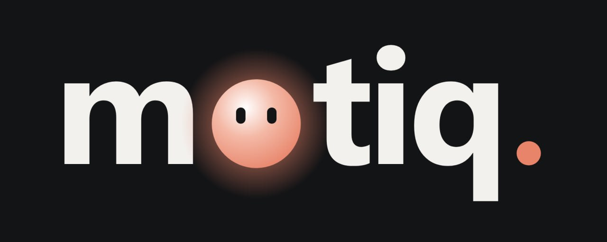
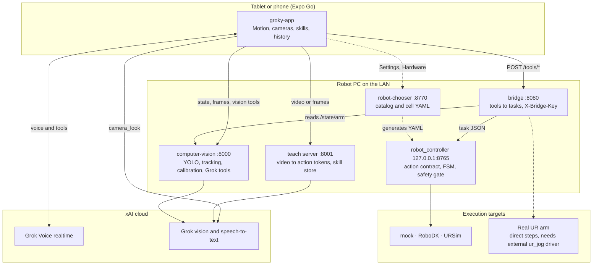
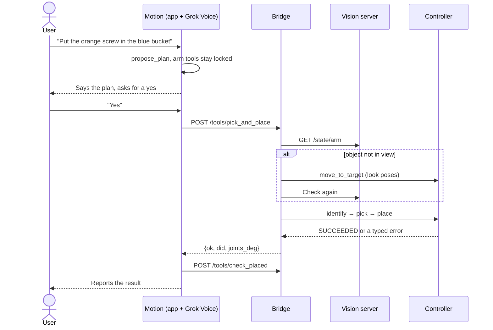
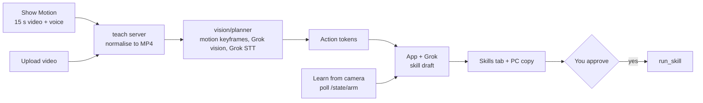

<p align="center">
  
</p>

<h1 align="center">MOTIQ:Intelligent Motion</h1>

<p align="center">
  <b>Tell a robot what to do, or show it once. It does the task, checks its own work with vision, and saves it as a reusable skill.</b>
</p>

<p align="center">
  <a href="#demo-videos">Demo videos</a> ·
  <a href="#quick-start">Quick start</a> ·
  <a href="#architecture">Architecture</a> ·
  <a href="#skills">Skills</a> ·
  <a href="#safety">Safety</a> ·
  <a href="#documentation">Documentation</a>
</p>

<p align="center">
  <a href="https://github.com/sirwinstontea/MOTIQ/stargazers"></a>
  <a href="https://github.com/sirwinstontea/MOTIQ/commits/main"></a>
  
  
  
  
  
  
  
</p>

### Robots should understand your intent—not require you to learn their language.

**Built during the Grok Hackathon — SpaceXAI**, MOTIQ began with a simple ambition: make commanding a robot as natural as explaining a task to another person.

Programming a robot can take longer than the task itself. Even a simple change may require specialist knowledge, manufacturer-specific tools, and time at the workstation. Switching robots often means learning another interface and adapting the workflow all over again.

**MOTIQ makes robot interaction a conversation.** Describe what you want, or demonstrate it, and the app turns your intent into a proposed sequence of actions. Through voice interaction, you can clarify the task, review the plan, and approve what happens next—from one interface designed to work across compatible robotic platforms.

Our vision is simple: **describe it, preview it in simulation, confirm it, then execute it on the physical robot.** RoboDK provides a space to inspect the intended behavior before authorizing hardware execution through a properly configured integration. Simulation supports that review; it does not replace physical safety checks.

We demonstrated app-based control with a physical UR5e. We’re building toward a broader goal: making robotic automation easier to adapt, easier to understand, and accessible without starting from scratch every time the robot or task changes.

MOTIQ is an end-to-end robot control stack driven by natural language and demonstration. You talk to **Motion**, a real-time Grok voice agent running in a React Native app on a tablet. Motion plans the task, asks for your approval, runs it through a typed and safety-gated controller, looks through a camera to confirm the result, and reports back. Show it a task on video and it writes a skill you can review, edit and run again.

During the event, we connected and controlled a **physical Universal Robots UR5e from the app**. The UR5e, a wrist-mounted Intel RealSense camera and a four-object tabletop scene form the reference cell; UR5e is the demonstrated integration, not the intended limit of robot compatibility.

The original concept also included coordination with a **CyberDog quadruped**. Time constraints prevented that integration from being completed during the hackathon. CyberDog connectivity and arm–quadruped coordination remain **future development**; existing dog profiles and in-app simulation are scaffolding, not a demonstrated physical integration.

> [!IMPORTANT]
> MOTIQ is a hackathon prototype, not a certified safety system. The controller runs in simulation only (mock, RoboDK or URSim). A separate, small set of direct step tools in the bridge can move a real UR arm when an external driver is installed. Read [Safety](#safety) before connecting hardware.

## Demo videos

### 1. MOTIQ — General showcase

Start here for the overall MOTIQ demo: an introduction to the application and its natural-language robotics workflow.

https://github.com/user-attachments/assets/b837132b-0d6d-4dc3-adf4-061935d76b04

### 2. Grok Voice × RoboDK — Simulation interaction

See Grok Voice interacting with MOTIQ and the RoboDK simulation. This demo focuses on conversational robot commands and the resulting simulated robot behavior, with a music soundtrack. It demonstrates simulation interaction, not physical-hardware safety validation.

https://github.com/user-attachments/assets/c433b312-f28f-40be-991c-45dd7797bb21

## Highlights

| | |
|---|---|
| **Voice agent** | Grok Voice runs the conversation and calls robotic-arm tools, in any language Grok Voice supports. Physical CyberDog integration remains future work. |
| **Teach by showing** | Record 15 seconds of video and speech with **Show Motion**, upload a video, or demonstrate in front of the arm camera. MOTIQ turns it into a skill draft. |
| **Vision in the loop** | YOLO plus ByteTrack gives stable numbered objects. YOLO-World follows new classes that Grok names. The eye-in-hand camera searches for objects before a pick and confirms the place. |
| **Skills as data** | Skills are JSON built from a closed primitive catalog. No model-generated code is ever executed. |
| **Layered safety** | Spoken plan approval, app-side kinematic checks, an allowlisted action contract, an explicit state machine, path checks and latched faults. |
| **Simulate first** | The same task JSON runs on `mock`, RoboDK, or URSim mirrored into RoboDK. |
| **Hardware as config** | Import a compatible arm model from the RoboDK library, configure its verified limits and cell with `robot-chooser`, and use the matching backend. Physical hardware additionally requires its driver and a compatible MOTIQ adapter. |
| **Replaceable brain** | Vision and planning use an OpenAI-compatible client, so xAI or OpenRouter work through environment variables. |

## Contents

- [Demo videos](#demo-videos)
- [Try saying](#try-saying)
- [Architecture](#architecture)
- [Repository structure](#repository-structure)
- [Requirements](#requirements)
- [Quick start](#quick-start)
- [Configuration](#configuration)
- [Skills](#skills)
- [Safety](#safety)
- [Extending MOTIQ](#extending-motiq)
- [Testing](#testing)
- [Troubleshooting](#troubleshooting)
- [Known limitations](#known-limitations)
- [Documentation](#documentation)
- [Contributing](#contributing)
- [Commercial development & partnerships](#commercial-development--partnerships)
- [Citation](#citation)
- [Team and acknowledgements](#team-and-acknowledgements)
- [License](#license)

## Try saying

```text
"What do you see?"
"Put the orange screw in the blue bucket."     → Motion proposes a plan and waits for your yes
"Yes."                                         → the arm finds, picks, places and verifies
"Move the arm 5 cm up and back down."
"Run the handover skill."
"In the pick skill, use the green ring instead."
"Stop!"                                        → never locked, halts everything
```

## Architecture

Each layer sits behind a small contract, so the tablet never needs to know which robot, simulator or model is behind it.



### Robot compatibility and event scope

MOTIQ is designed to interact with different robotic arms through the same application and conversational workflow. For RoboDK integration, the arm must be **available in the RoboDK robot library and imported into the station**, with matching robot configuration, verified joint and motion limits, TCP/tool and reference frames, workspace, scene and safety settings. Select and validate it through [`robot-chooser`](robot-chooser). Importing a model alone does not make every action supported or establish compatibility with every robot; the backend, task definitions and app capabilities must match the selected arm.

The same app interface can also control a **physical robot when the corresponding driver is installed and integrated through a compatible MOTIQ bridge/backend adapter**. A RoboDK model or installed driver alone is not a physical-control integration. In this event, that hardware integration was the **UR5e**. The physical step tools currently described below are UR-specific; the packaged task controller remains simulation-only. Supporting another manufacturer's hardware requires its appropriate driver, adapter and cell-specific validation. Simulation success is not proof of physical safety.

CyberDog was part of the proposed architecture, but its physical connection, control and coordination with the arm were **not integrated by the end of the event**. Dog-related UI, profiles and mock behavior should be understood as groundwork for that future work, not as completed capabilities.

### Contracts

| Boundary | Contract | Why it matters |
|---|---|---|
| App ↔ robot | `GET /health`, `POST /tools/<name>`, `POST /tools/stop`, optional `GET /camera.jpg` | Anything that speaks this protocol can be a robot. An empty URL means the app simulates it. |
| App ↔ vision | [`computer-vision/API_APP.md`](computer-vision/API_APP.md) | The app embeds no detector. |
| App ↔ teach | `POST /teach`, `POST /teach_frames`, `GET/POST/DELETE /skills` | Video goes in, action tokens come out. The app writes the skill. |
| Bridge ↔ controller | [`AI_ACTION_CONTRACT.md`](robot_controller/docs/AI_ACTION_CONTRACT.md) | Only allowlisted high-level actions on registered IDs. No raw XYZ, joints or scripts. |
| Skills ↔ arm | MOTIQ skill schema 1.1.0 with a closed primitive catalog | Skills are data, not code. |
| Cell ↔ controller | YAML generated by [`robot-chooser`](robot-chooser) | A new arm or device is configuration. |

### What happens on a voice command



### How a demonstration becomes a skill



## Repository structure

```text
MOTIQ/
├── groky-app/               React Native app (Expo): Motion, cameras, skills, history
├── bridge/                  App tool protocol → controller tasks; direct UR step tools
├── robot_controller/        Typed, safety-gated controller with swappable backends
├── computer-vision/         Perception server, Grok vision toolkit, video planner
├── computer-vision-to-app/  One-command vision setup and the teach server
├── robot-chooser/           Robot catalog and cell description → controller config
└── assets/                  Logo
```

| Component | Role | Stack | Default port |
|---|---|---|---|
| [`groky-app`](groky-app) | User interface and voice agent | Expo SDK 58, React Native 0.88, TypeScript | Metro on the laptop |
| [`bridge`](bridge) | Exposes tools on the LAN and maps them to tasks | FastAPI, httpx | 8080 |
| [`robot_controller`](robot_controller) | Task FSM, safety policy, backends, dashboard | Pydantic, FastAPI, RoboDK API, `ur_rtde` | 8765 (loopback) |
| [`computer-vision`](computer-vision) | Detection, tracking, masks, calibration, Grok tasks, planner | Ultralytics, OpenCV, FastAPI, ffmpeg | 8000 |
| [`computer-vision-to-app`](computer-vision-to-app) | Vision installer, `.env` wiring, video → tokens | Python standard library + planner | 8001 |
| [`robot-chooser`](robot-chooser) | Arm catalog, hardware components, requirements report | Pydantic, PyYAML, stdlib HTTP server | 8770 (loopback) |

Every folder has its own README with a file-level guide.

## Requirements

| Piece | Needs |
|---|---|
| Client | A phone or tablet with [Expo Go](https://expo.dev/go). This is the intended client. |
| Dev laptop | Node.js 20+ and npm, to run Metro |
| Robot PC | Python 3.10–3.12 recommended, ffmpeg (optional, `imageio-ffmpeg` is the fallback) |
| API key | An xAI key for voice. Vision and planning also accept an OpenRouter key. |
| Camera (optional) | Intel RealSense D415/D435 or any webcam. `--mode synthetic` runs without one. |
| RoboDK (optional) | RoboDK with the GUI running, for `robodk_sim` and `ursim_sync` |
| URSim (optional) | Docker and `ur_rtde`, for `ursim_sync` |

`bridge/start_stack.sh` is written for Linux. On Windows, start each service with the commands in [Full simulated stack](#3-full-simulated-stack). The first time the vision server loads YOLO-World it downloads the model weights, including a CLIP model of about 340 MB.

## Quick start

### 1. App only (simulated robots)

This takes a few minutes and needs no robot PC.

```bash
git clone https://github.com/sirwinstontea/MOTIQ.git
cd MOTIQ/groky-app
npm install
cp .env.example .env        # set EXPO_PUBLIC_XAI_API_KEY
npx expo start              # scan the QR code with Expo Go
```

With `EXPO_PUBLIC_ARM_URL` empty, the arm runs in the in-app simulator. An empty `EXPO_PUBLIC_DOG_URL` also leaves the existing dog UI in mock mode; this does not provide a physical CyberDog integration. On venue Wi-Fi, use `npx expo start --tunnel`.

### 2. Controller demo (no app, no camera)

```bash
cd robot_controller
python -m venv .venv && source .venv/bin/activate    # Windows: .venv\Scripts\activate
pip install -e ".[dev]"
python -m robot_control.cli demo --backend mock --task examples/pick_place.json
```

### 3. Full simulated stack

Install both environments once, from the repo root:

```bash
python computer-vision-to-app/run.py setup           # computer-vision/.venv
cd robot_controller && python -m venv .venv && .venv/bin/pip install -e ".[dev]" && cd ..
```

**Linux**, with one command:

```bash
BRIDGE_KEY='pick-a-long-secret' BACKEND=mock VISION_MODE=synthetic ./bridge/start_stack.sh
# BACKEND=mock VISION=0   no camera or vision server
# no BACKEND              uses config/robot.yaml, starts RoboDK if the backend needs it
```

**Windows**, in three terminals from the repo root:

```powershell
# 1. Vision + teach, and writes both URLs into groky-app/.env
python computer-vision-to-app\run.py all --mode synthetic

# 2. Controller
cd robot_controller
.venv\Scripts\python -m robot_control.cli serve --backend mock --detector vision_file --vision-file runs\vision_bridge.json

# 3. Bridge
$env:BRIDGE_KEY = "pick-a-long-secret"
robot_controller\.venv\Scripts\python bridge\motiq_bridge.py --vision http://127.0.0.1:8000
```

Then point the app at the robot PC. Use its **LAN IP**: `127.0.0.1` on a phone means the phone.

```bash
# groky-app/.env
EXPO_PUBLIC_XAI_API_KEY=xai-...
EXPO_PUBLIC_ARM_URL=http://192.168.x.x:8080
EXPO_PUBLIC_BRIDGE_KEY=pick-a-long-secret
EXPO_PUBLIC_VISION_SERVER=http://192.168.x.x:8000
EXPO_PUBLIC_TEACH_SERVER=http://192.168.x.x:8001
```

Restart with `npx expo start -c`, because `EXPO_PUBLIC_*` values are built into the bundle. To check the connection, open `http://192.168.x.x:8000/health` in the tablet's browser.

### 4. RoboDK digital twin

```bash
cd robot_controller
cp config/robot.example.yaml config/robot.yaml       # set backend: robodk_sim
python -m robot_control.cli setup-station --config config/robot.yaml
python -m robot_control.cli demo --backend robodk_sim --task examples/pick_place.json --config config/robot.yaml
```

See [`robot_controller`](robot_controller) for URSim sync and the live dashboard.

### After a stop or a fault

The controller latches `CANCELLED` and `FAULT`, and refuses new tasks until an operator resets it **on the robot PC**. The bridge never forwards this call, so the voice agent cannot clear a fault.

```bash
curl -X POST localhost:8765/operator/reset -H 'content-type: application/json' -d '{"operator":"your-name"}'
```

## Configuration

### Ports

| Port | Service | Bind |
|---|---|---|
| 8000 | Vision server | `0.0.0.0` by default |
| 8001 | Teach server | `0.0.0.0` by default |
| 8080 | Arm bridge | `0.0.0.0`, needs `BRIDGE_KEY` of 8+ characters |
| 8765 | Controller API and dashboard | `127.0.0.1`. Other addresses need `ROBOT_API_PASSWORD`. |
| 8770 | robot-chooser UI and API | `127.0.0.1`, no authentication |
| 20500 | RoboDK API | Local |

> [!WARNING]
> The vision and teach servers have no authentication and open CORS. Run them on a trusted network only. `EXPO_PUBLIC_XAI_API_KEY` is compiled into the JS bundle, so use it on your own devices only. For anything shared, set `EXPO_PUBLIC_TOKEN_URL` to a backend that mints short-lived tokens.

### App (`groky-app/.env`)

| Variable | Purpose | Default |
|---|---|---|
| `EXPO_PUBLIC_XAI_API_KEY` | xAI key for voice and `camera_look` | |
| `EXPO_PUBLIC_TOKEN_URL` | Backend that returns the body of `POST /v1/realtime/client_secrets` | |
| `EXPO_PUBLIC_GROK_VOICE_MODEL` | Realtime model | `grok-voice-latest` |
| `EXPO_PUBLIC_GROK_VOICE` | Voice name | `eve` |
| `EXPO_PUBLIC_GROK_LANGUAGE_HINT` | BCP-47 hint for speech recognition. Empty means auto-detect. | |
| `EXPO_PUBLIC_GROK_VISION_MODEL` | Model behind `camera_look` | `grok-4.20-0309-non-reasoning` |
| `EXPO_PUBLIC_VISION_URL` | Optional proxy for vision calls | |
| `EXPO_PUBLIC_ARM_URL`, `EXPO_PUBLIC_DOG_URL` | Arm bridge and future dog bridge. Empty means simulated; physical CyberDog integration is not completed. | |
| `EXPO_PUBLIC_BRIDGE_KEY` | Sent as `X-Bridge-Key` | |
| `EXPO_PUBLIC_VISION_SERVER` | Vision server URL | |
| `EXPO_PUBLIC_VISION_SOURCES` | Sources listed as cameras | `arm,webcam` |
| `EXPO_PUBLIC_TEACH_SERVER` | Teach server URL | |
| `EXPO_PUBLIC_CHOOSER_URL` | robot-chooser URL for Settings → Hardware | |
| `EXPO_PUBLIC_CAMERAS` | Extra JPEG cameras, `Name=url,Name=url` | |

### Vision and teach (`computer-vision/.env`)

| Variable | Purpose | Default |
|---|---|---|
| `XAI_API_KEY` | xAI or OpenRouter key | |
| `XAI_BASE_URL` | OpenAI-compatible endpoint | `https://api.x.ai/v1`, set to OpenRouter in `.env.example` |
| `XAI_MODEL` | Vision model | `grok-4.7`, `x-ai/grok-4.7` in `.env.example` |
| `XAI_STT_API_KEY` | xAI key for speech-to-text in the planner | |
| `GROK_MOCK` | `1` gives deterministic offline answers | `0` |
| `GROK_TIMEOUT` | Seconds per Grok call, retries included | `8`, `30` in `.env.example` |
| `GROK_REASONING` | `minimal`, `low`, `medium`, `high` | `minimal` |
| `YOLO_MODEL` | Detector weights | `data/models/oggetti_mani.onnx` |

The teach server reuses `EXPO_PUBLIC_XAI_API_KEY` from the app `.env` when `XAI_API_KEY` is not set.

## Skills

A skill is a JSON document in the MOTIQ skill format (schema 1.1.0): intent, success conditions, robot profile, action primitives, environment objects, constraints, steps, interpretation, safety and review state. The reference is [`pick_place_ur5e.json`](groky-app/src/skills/templates/pick_place_ur5e.json).

```jsonc
// shape of one step
{
  "id": "step_003",
  "action": "PICK",                                  // DETECT, PICK, PLACE, VERIFY, SEQUENCE, ...
  "target": "orange_screw_03",
  "primitive_sequence": [
    { "primitive": "MOVE_ABOVE", "parameters": { "target": "orange_screw_03" } },
    { "primitive": "CLOSE_GRIPPER" }
  ],
  "failure_policy": "RETRY_WITH_REOBSERVATION"
}
```

Skills come from four places:

| Source | How |
|---|---|
| Voice | A completed voice command is saved from the tool calls that actually ran. |
| Prompt | Describe the task. Grok drafts the skill and the app fills in every default. |
| Camera | **Learn from camera** works out which objects moved where from `/state/arm`. |
| Video | **Show Motion** or **Upload video** go through `vision/planner`. |

Before a skill runs, the app can dry-run it against a UR5e kinematic model, animate a 2D preview, and check whether the cell can physically do it. Drafts stay drafts until a person approves them. Learned skills are stored in the app and in `computer-vision/data/skills/learned/` on the robot PC.

## Safety

MOTIQ reduces software risk. It does not replace the UR safety configuration, a protective stop, an E-stop, a risk assessment or a trained operator. `stop` is a controlled software request, **not** an emergency stop. A clean simulation result says nothing about the physical cell. See [`SAFETY_BOUNDARIES.md`](robot_controller/docs/SAFETY_BOUNDARIES.md).

### Two motion paths

| Path | Tools | What moves | Checks |
|---|---|---|---|
| **Controller tasks** | `pick_and_place`, `pick`, `place`, `shake`, `find`, `scan`, `check_placed`, `home`, `open_gripper`, `move_above` | Simulator only: `mock`, RoboDK in `RUNMODE_SIMULATE`, or URSim on loopback. `physical_disabled` refuses every motion. | Allowlisted IDs, preflight, joint and workspace limits, reach, speed, path check, fault latch |
| **Direct bridge steps** | `move_up/down/left/right/forward/backward`, `move_joint`, `rotate_yaw`, `ur_down_up`, `ur_visit` | A **real UR arm**, sending URScript to port 30002, only if `ur_manual/ur_jog.py` exists beside the repo folder. It is not in this repository. Without it, these tools are refused. | Bridge caps: 10 cm per step, 30° per joint move, 5 cm for `ur_down_up`, 35 cm of travel for `ur_visit`, 50 mm/s, stoppable. These do **not** pass through the controller's safety gate. |

In the app, "real" means a bridge URL is set. Behind that URL, controller tasks still run on a simulator.

### Approval layers

| Layer | What it does |
|---|---|
| Plan approval | Motion must call `propose_plan` and get a spoken or typed yes before any arm motion or `run_skill`, in the simulator as well. Grok cannot approve its own plan. A no, a stop, a new request or 5 minutes ends the approval. |
| Skill approval | A saved skill needs Skills-tab approval to reach hardware unless **full access** is on. Full access is on at every start. Say "safe mode" to turn it off. Editing a skill drops its approval. |
| Unmeasured positions | With `NEEDS_VALIDATION`, the default, a real run refuses objects whose position wasn't measured by a calibrated camera. |
| App checks | Each arm primitive is checked against limits, joint ranges, reach, the base singularity and the table plane before it's sent. |
| Controller gate | Fail-closed checks before every action and motion segment. A denial is `REJECTED`, and there is no fallback to a weaker backend. |
| Faults | `FAULT` and `CANCELLED` latch until an operator resets the controller from the robot PC. |
| Stop | `stop` is never locked. |

## Extending MOTIQ

| To add | Do this | Code change |
|---|---|---|
| Another arm in RoboDK | Import its library model and add a `catalog.yaml` entry with verified limits, its own scene, TCP and workspace | Configuration for compatible backends; an adapter if unsupported |
| Another physical arm | Install its manufacturer-appropriate driver and integrate it with the MOTIQ bridge/backend; validate the actual cell | Driver/adapter integration as required |
| A gripper, camera, sensor or conveyor | Add a component in `hardware.yaml` | None |
| A new kind of device | Add `hardware_types/<type>.yaml`. Forms, validation and the CLI pick it up. | None |
| A robot behind the app | Implement the bridge protocol and set `EXPO_PUBLIC_*_URL` | Your bridge |
| A controller backend | Implement `RobotController` in `robot_control/backends/` | One adapter |
| A different LLM host | Set `XAI_BASE_URL`, `XAI_MODEL`, `XAI_API_KEY` | None |
| New detector weights | Set `YOLO_MODEL` and map its classes in the scene's `class_labels` | None |
| A new skill | Generate, import or write the JSON | None |

The arm is selected in `robot-chooser` by CLI, web UI or **Settings → Hardware** in the app. Restart the controller and bridge afterwards, because a running controller does not switch robots live. If the selection is `BLOCKED`, the controller refuses to start. A catalog entry is not proof of readiness: each model needs its own verified configuration and imported RoboDK model. The UR5e is the arm connected and controlled during the event; this is not a claim that every catalog model has been physically tested.

## Testing

```bash
# Controller
cd robot_controller && python -m pytest -q

# Robot chooser (uses the controller's venv)
cd robot-chooser && ../robot_controller/.venv/bin/python -m pytest -q

# Vision, Grok tools and planner, offline
cd computer-vision && GROK_MOCK=1 .venv/bin/python -m pytest -q tests vision/grok/tests

# App
cd groky-app && npm run typecheck && npm run lint && npm run test:voice
```

| Suite | Result on 5 November 2026 |
|---|---|
| `robot_controller` | 144 passed, 5 opt-in integration tests deselected |
| `robot-chooser` | 47 passed |
| `computer-vision` + `vision/grok` | 181 passed, 2 skipped |
| `groky-app` `test:voice` | All checks passed |

RoboDK and URSim integration tests are opt-in with `RUN_ROBODK_TESTS=1` and `RUN_URSIM_TESTS=1`. The repository has no CI yet.

> [!TIP]
> **Before you run the suites**, a few things keep the results clean:
>
> - **Windows:** the digital twin service uses Linux file locking. Run the controller suite with `--ignore=tests/test_digital_twin_service.py`, or use Linux or WSL if you need the digital twin.
> - **No URSim or `ur_jog` driver on this PC:** add `--deselect tests/test_bridge_push_overview.py`. Those tests expect Docker with URSim and the physical-arm driver.
> - **App checks:** use `npm run typecheck` and `npm run test:voice`. `npm run lint` applies strict React hook rules that some screens don't follow yet.
> - **Benchmark:** `benchmark/cross_tokenize.py` looks for `Groky_Planner_Agent/` at the repo root. Copy or link `computer-vision/Groky_Planner_Agent` there first. That folder is the earlier standalone planner kept for the benchmark. The live one is `computer-vision/vision/planner`.
> - **Faster clone:** the detector models make the full history about 70 MB. `git clone --depth 1` is enough to run everything.
> - **Contributing:** add `__pycache__/`, `*.pyc` and `.DS_Store` to your global gitignore so they don't end up in commits.

## Troubleshooting

| Symptom | Fix |
|---|---|
| App shows "No signal" | Open `http://<pc-ip>:8000/health` on the tablet. Check Wi-Fi isolation and the firewall, use the LAN IP, restart with `npx expo start -c`. |
| Show Motion fails | `EXPO_PUBLIC_TEACH_SERVER` must be a LAN IP. Check the teach server log. |
| Expo Go can't load the app | Join the same Wi-Fi as Metro, or use `npx expo start --tunnel`. |
| Voice works, the arm doesn't move | Motion is waiting for your yes, the skill needs approval, or `EXPO_PUBLIC_ARM_URL` is empty. |
| `arm_move_up` is refused | There is no `ur_jog` driver on this PC, or the arm isn't reachable. |
| Bridge refuses a pick | The object isn't in view or isn't mapped. Check `/state/arm` and the scene's `class_labels`. |
| Every task is refused after a stop | Run the operator reset on the robot PC. |
| Controller exits at startup | Run `python -m robot_chooser status` and fix the blockers. |
| Bridge won't start | Set `BRIDGE_KEY` to 8+ characters. |
| Camera busy | One process per camera. Close `run_demo.bat`, RealSense Viewer and other apps. |
| Package install fails | Use Python 3.10–3.12. |

## Known limitations

- Controller tasks are simulation only. There is no real gripper driver, payload calibration or physical backend.
- Some skill templates and app-side kinematic previews on `main` remain UR5e-specific. Importing another RoboDK model does not automatically adapt those paths or validate all actions for that robot.
- The cell's tool is a rigid, non-actuated 3D-printed part, so grasps are symbolic and grasp targets are placeholders to re-teach.
- Picks use taught targets. Camera positions are not used for motion yet.
- The external physical UR driver, `ur_jog.py`, is not in this repository. Other physical arms require their own compatible driver/adapter integration; the generic task controller is not a physical backend.
- Physical CyberDog integration and coordinated arm–quadruped operation were not completed because of hackathon time constraints and remain future work. Existing dog mocks are not hardware support.
- `calibration_skill` still needs a small app patch before it can run from the app.
- The mic is muted while Motion speaks, so use the stop button to interrupt.
- `robot-chooser` selects one active arm per controller, and changes need a restart.
- The vision server and voice context serve one user at a time.

## Documentation

| Guide | Covers |
|---|---|
| [`groky-app/README.md`](groky-app/README.md) | App tabs, voice session, tools, skills |
| [`bridge/README.md`](bridge/README.md) | Tool map, eye-in-hand search, physical steps |
| [`robot_controller/README.md`](robot_controller/README.md) | Backends, CLI, HTTP API, demo objects |
| [`robot_controller/docs/`](robot_controller/docs) | Action contract, states, safety, vision integration, RoboDK on Linux |
| [`computer-vision/README.md`](computer-vision/README.md) | Perception server, calibration, models |
| [`computer-vision/API_APP.md`](computer-vision/API_APP.md) | Vision HTTP and WebSocket reference (Italian) |
| [`computer-vision/vision/eyes`](computer-vision/vision/eyes) | Detection, tracking, masks, server |
| [`computer-vision/vision/grok`](computer-vision/vision/grok) | Grok vision tasks and voice tools |
| [`computer-vision/vision/planner`](computer-vision/vision/planner) | Video → tokens → skills → execution |
| [`computer-vision-to-app/README.md`](computer-vision-to-app/README.md) | `run.py` and the teach server |
| [`robot-chooser/README.md`](robot-chooser/README.md) | Catalog, components, hardware types, API |

## Contributing

Issues and pull requests are welcome. For the team's hackathon responsibilities, see [Contributor roles](#contributor-roles).

1. Keep skills as data. Don't add a path that runs model-generated code.
2. Keep new motion behind the controller's action contract and safety gate.
3. Add tests for backend changes, and run the suites above before opening a pull request.
4. Never commit `.env` files, keys or generated `config/*.yaml`.

## Commercial development & partnerships

Interested in taking MOTIQ beyond the hackathon prototype? We welcome inquiries about **paid commissioned development, custom robot integrations, deployment and technical support**.

Scope, deliverables, fees, intellectual-property rights, maintenance and applicable third-party licenses will be agreed separately for each engagement.

For initial inquiries, contact a project maintainer through the GitHub profiles in [Team and acknowledgements](#team-and-acknowledgements).

## Citation

```bibtex
@software{motiq2026,
  title  = {MOTIQ: Intelligent Motion},
  author = {{MOTIQ contributors}},
  year   = {2026},
  url    = {https://github.com/sirwinstontea/MOTIQ}
}
```

## Team and acknowledgements

<a href="https://github.com/sirwinstontea/MOTIQ/graphs/contributors">
  
</a>

Built by [sirwinstontea](https://github.com/sirwinstontea), [piniz-dev](https://github.com/piniz-dev), [aman-abeb](https://github.com/aman-abeb), [filippodinoia-svg](https://github.com/filippodinoia-svg), [r-46n0](https://github.com/r-46n0) and [josefariasfuentes](https://github.com/josefariasfuentes).

### Contributor roles

#### José Alfonso Farías Fuentes ([@josefariasfuentes](https://github.com/josefariasfuentes))

**Project Coordination, Robotics Architecture & System Integration**

- Initiated and helped define the project concept, objectives and overall system architecture, including the proposed coordination between a robotic arm and quadruped robot.
- Coordinated development activities, distributed responsibilities and established integration priorities across the team.
- Defined high-level robotic task execution logic, including action sequences, operating states, communication requirements and failure-handling considerations.
- Prepared technical documentation describing the architecture, robot control actions and JSON-based task definitions.
- Contributed to the integration strategy involving RoboDK, URSim and robotic hardware, including digital-twin synchronization and communication requirements.
- Coordinated safety considerations and participated in robotic system integration and testing.

#### [@sirwinstontea](https://github.com/sirwinstontea)

**Grok Voice Integration, Application Development & Robot Configuration**

- Developed major components of the MOTIQ application using React Native, Expo and TypeScript.
- Integrated Grok Voice for real-time conversational interaction, robot commands and multilingual voice approvals.
- Developed application functionality for task execution, robot monitoring, skill creation, editing and reuse.
- Implemented interfaces for robot configuration, supported devices and hardware selection.
- Developed Robot Chooser for configuring different robot models, operational constraints and associated hardware.
- Contributed to integrating the application with vision services and task-learning workflows.

#### Filippo Pinizzotto ([@piniz-dev](https://github.com/piniz-dev))

**Computer Vision, Perception & Camera Calibration**

- Developed foundational components of the computer-vision subsystem for detecting and recognizing objects in the robotic workspace.
- Integrated Intel RealSense and webcam-based image acquisition.
- Worked on YOLO-based object detection, including custom-trained models.
- Developed camera calibration using ArUco markers and camera-to-robot transformations.
- Contributed to connecting perception results with Grok and robotic task execution.

#### Amanuel ([@aman-abeb](https://github.com/aman-abeb))

**Robot Control Integration, Backend & Digital Twin**

- Developed and extended MOTIQ Bridge components connecting application-level commands to robotic execution services.
- Integrated robotic task commands, action execution and communication between the application and controller.
- Developed arm movement functionality, pose management and vision-guided operations.
- Contributed to simulation, digital-twin synchronization and integration with robotic hardware.
- Implemented features related to task execution, visual-search workflows and reusable robotic skills.
- Contributed to backend integration and communication between system modules.

#### [@filippodinoia-svg](https://github.com/filippodinoia-svg)

**3D Modeling**

- Designed and modeled the 3D robotic gripper used in the project during the hackathon. The gripper CAD/model file is not currently versioned in this repository and will be added when available.

**Computer Vision Integration & Grok Perception Tools**

- Integrated YOLO-World and custom ONNX object-detection models into the perception pipeline.
- Contributed to Grok Vision integration with camera and object-recognition functionality.
- Improved camera-source handling, including PC webcam compatibility.
- Developed updates to camera acquisition, visual processing and application-side camera components.
- Contributed to making computer-vision functionality accessible through MOTIQ.

#### [@r-46n0](https://github.com/r-46n0)

**Object Tracking, Visual Verification & AI Task Planning**

- Developed object tracking functionality using YOLO and ByteTrack.
- Implemented visual verification of object presence and changes in predefined areas.
- Developed image-processing features, including color estimation and digital zoom management.
- Contributed to the Grok-based planning architecture for translating demonstrations and task descriptions into robotic actions.
- Developed planning utilities, action-token processing, reusable skill representations, benchmarks and tests.

MOTIQ builds on [xAI Grok](https://x.ai), [Expo](https://expo.dev), [Ultralytics YOLO](https://github.com/ultralytics/ultralytics), [ByteTrack](https://github.com/ifzhang/ByteTrack), [OpenCV](https://opencv.org), [RoboDK](https://robodk.com), [URSim](https://www.universal-robots.com/download/) and [Intel RealSense](https://www.intelrealsense.com). Thanks to the Ctrl+Alt Museum in Pavia for hosting the hackathon.

## License

This repository does not include a license file yet, so all rights are reserved by its authors until one is added.
