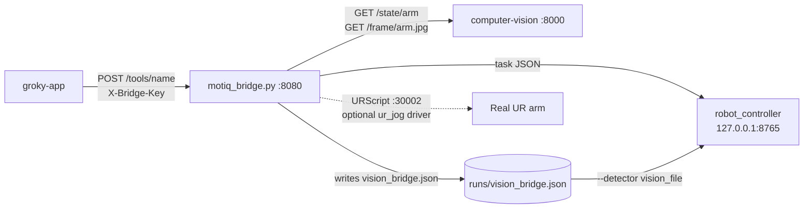

# MOTIQ bridge

The only robot service exposed on the LAN. It turns the app's tool calls into `robot_controller` tasks, feeds vision detections to the controller, searches for objects with the arm camera, and hosts a small set of direct step tools for a real UR arm.



## Run

**Linux**, whole stack on the robot PC:

```bash
BRIDGE_KEY=pick-a-secret ./bridge/start_stack.sh
BRIDGE_KEY=pick-a-secret BACKEND=mock VISION=0 ./bridge/start_stack.sh     # no RoboDK, no camera
```

| Variable | Default | Meaning |
|---|---|---|
| `BRIDGE_KEY` | required | Shared secret, 8+ characters. Same value as `EXPO_PUBLIC_BRIDGE_KEY`. |
| `BACKEND` | `config/robot.yaml` | `mock`, `robodk_sim`, `ursim_sync` |
| `VISION` | `1` if `computer-vision/.venv` exists | Start the vision and teach servers |
| `VISION_MODE` | `auto` | `realsense`, `webcam`, `synthetic`, ... |
| `BRIDGE_PORT`, `TEACH_PORT`, `CTRL_PORT` | `8080`, `8001`, `8765` | Ports |

Any backend except `mock` starts RoboDK from `~/RoboDK/RoboDK-Start.sh` if it isn't running, and loads `stations/UR5e_demo.rdk`. Create that file first with `setup-station`.

**Any OS**, bridge alone. It runs in the controller's venv:

```bash
BRIDGE_KEY=pick-a-secret robot_controller/.venv/bin/python bridge/motiq_bridge.py --vision http://127.0.0.1:8000
```

| Flag | Default |
|---|---|
| `--host`, `--port` | `0.0.0.0`, `8080` |
| `--controller` | `$CONTROLLER_URL` or `http://127.0.0.1:8765` |
| `--vision` | `$VISION_URL`. Empty means no vision. |
| `--scene` | `robot_controller/config/scene.yaml`, else `scene.example.yaml` |
| `--vision-file` | `robot_controller/runs/vision_bridge.json` |
| `--task-timeout` | `180` s |
| `--min-conf` | `0.6`, matches the controller's `min_detection_confidence` |

The bridge refuses to bind to a network address without a `BRIDGE_KEY` of 8+ characters.

## HTTP API

Every route needs `X-Bridge-Key`, including `/health`.

| Route | Purpose |
|---|---|
| `GET /health` | Bridge, controller, vision and physical arm status. Reports the live `model` and `dof`. |
| `GET /camera.jpg?raw=false` | Latest arm frame, proxied from the vision server |
| `POST /tools/{name}` | Run a tool and wait for it. Returns `{ok, did or error, joints_deg, ...}`. |
| `POST /tools/stop` | Cancel the active task and search, then stop. Works while a task runs. |
| `GET /speed`, `POST /speed` | Read or set arm speed as a percentage of the model's maximums. Refused while a task runs. |

Status codes: `200` success, `400` refused or bad arguments (nothing was sent to the robot), `401` wrong key, `409` the task failed, `502` the controller is unreachable.

## Tools

Grok sees these tools with an `arm_` prefix: `arm_pick_and_place` becomes `POST /tools/pick_and_place`.

### Controller tasks (simulator)

| Tool | Arguments | Controller action |
|---|---|---|
| `pick_and_place` | `object`, `destination?`, `shake_cycles?` | identify → pick → (shake) → place |
| `pick` | `object` | identify → pick |
| `place` | `destination?` | place |
| `shake` | `cycles?`, `pattern?` | `shake_object` |
| `home` | | `perform_motion go_home` |
| `open_gripper` | | `release_object` |
| `move_above` | `target` | `move_to_target` on the approach target |
| `find` | `object` | Move through look poses until the camera sees it |
| `scan` | | Visit every scan pose and report which objects are on the table |
| `check_placed` | `object`, `destination` | Look at the destination after a place |
| `status` | | Controller `GET /status` |

`object` can be a scene ID (`orange_screw_03`), a name (`orange screw`, `vite arancione`) or a vision track number (`3`). Destinations are `delivery_zone`, `blue bucket` (`blue_bucket_01_inside`, a drop into the bucket) or `<object>_slot`.

### Direct physical steps (real UR arm)

These need `ur_manual/ur_jog.py` in the folder **next to** the repo. It isn't in this repository. Without it the bridge logs `physical arm disabled` and refuses these tools. They run one at a time and are refused while a controller task is active.

> [!CAUTION]
> These tools send URScript straight to the robot on port 30002. They do not pass through the controller's safety gate. Their only software limits are the caps below and the app-side checks. Keep the robot's own safety configuration active and a hand on the E-stop.

| Tool | Arguments | Limit |
|---|---|---|
| `move_up/down/left/right/forward/backward` | `distance_m` | 10 cm per call, 50 mm/s |
| `move_joint` | `joint`, `delta_deg` or `target_deg` | `ur_jog.MAX_JOINT_DEG`, 30° per the protocol |
| `rotate_yaw` | `angle_deg` | Wrist 3, same joint cap |
| `ur_down_up` | `mm` | Straight down and back up, 50 mm at most |
| `ur_visit` | `object`, `hold_s`, `come_back` | Centres the camera over an object. Moves sideways only, 35 cm from the start at most. |

### Refused

`rotate_roll`, `rotate_pitch`, `move_joints`, `move_to_pose` and `close_gripper` return `400`. They only work in the app's simulator.

## Vision and eye-in-hand search

Before a task that needs an object, the bridge reads `/state/arm`, maps tracks to registered IDs through the scene's `class_labels` (colour aware, so `vite` + `arancione` is the orange screw), and writes them to the file the controller's `vision_file` detector reads. If the object isn't found, the pick is refused up front, so no FAULT gets latched. `coords_mm` is not used: picks go to taught targets.

With `search.camera: arm_mounted` in the scene, "not in view" means "not in view from here". The bridge looks straight down at the object's taught spot, then visits `scan_center`, `scan_right`, `scan_left` and `scan_delivery`. It stops when a frame taken after the arm has settled shows the object at 60% confidence or more. Each look pose is an ordinary `move_to_target` with the usual controller checks, and `/tools/stop` ends a search between poses. Scan poses are placeholders for the demo table, so re-teach them on a real cell.

## After a stop or a failed task

The controller latches `CANCELLED` and `FAULT`. Reset it on the robot PC:

```bash
curl -X POST localhost:8765/operator/reset -H 'content-type: application/json' -d '{"operator":"<your name>"}'
```

That endpoint only accepts loopback callers and the bridge never forwards it, so Grok can't clear a fault.

## Files

| File | Purpose |
|---|---|
| [`motiq_bridge.py`](motiq_bridge.py) | Bridge server: tool routing, vision mapping, search, physical arm |
| [`start_stack.sh`](start_stack.sh) | Starts vision, teach, RoboDK, controller and bridge on Linux |

There are no automated bridge tests yet. Smoke-test with `BACKEND=mock VISION=0`.
