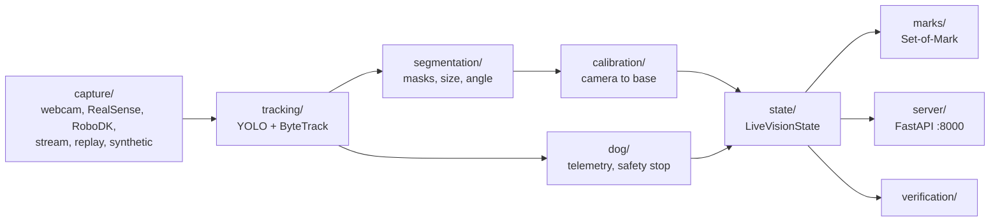

# vision/eyes

Fast local perception, known in the team as Vision A ("the eyes"). It captures frames, detects and tracks objects, measures them, and publishes the result over HTTP and WebSocket. Grok is never called per frame.



## Modules

| Folder | Purpose |
|---|---|
| [`capture/`](capture) | Interchangeable frame sources with one reader interface |
| [`tracking/`](tracking) | Detection, stable IDs, normalised boxes, dominant colour |
| [`segmentation/`](segmentation) | Object masks from an empty-table reference or GrabCut, plus measurements |
| [`depth/`](depth) | Monocular distance estimate when there is no depth camera |
| [`calibration/`](calibration) | ArUco homography, fixed look pose, hand-eye |
| [`marks/`](marks) | Numbered object overlays for video and Grok |
| [`dog/`](dog) | Visual following telemetry and the person or hand safety stop |
| [`state/`](state) | Thread-safe `VisionState` shared with `vision/grok` |
| [`verification/`](verification) | Deterministic checks of whether an object left or arrived |
| [`zoom/`](zoom) | Smooth digital zoom for the desktop demo |
| [`server/`](server) | MJPEG, WebSocket and REST server |

| File | Purpose |
|---|---|
| [`cli.py`](cli.py) | Command line |
| [`pipeline.py`](pipeline.py) | `SourceNode` per camera and the `EyePipeline` loop |
| [`schemas.py`](schemas.py) | `EyeObject`, `FramePayload`, `DogTelemetry`, `CoordsMM` |

## Command line

Run from `computer-vision/`.

```bash
# Live server
python -m vision.eyes.cli run --mode auto --port 8000
python -m vision.eyes.cli run --mode synthetic
python -m vision.eyes.cli run --mode replay --file data/replays/sample_arm.mp4

# One perception cycle, printed as JSON
python -m vision.eyes.cli inspect --mode replay --file data/replays/sample_arm.mp4 --save-marked data/sample_marked.jpg

# Make a replay video
python -m vision.eyes.cli generate-replay --output data/replays/sample_arm.mp4
```

Key options for `run`: `--mode auto|realsense|robodk|webcam|replay|stream|synthetic`, `--device`, `--file`, `--dog-target`, `--fps`, `--host`, `--port`, `--mock-tracker`, `--color-labels`, `--no-webcam`, `--webcam-device`, `--fixed-pose`, `--hand-eye`, `--controller`, `--look-pose`, `--robot-ip`, `--robot-pose controller|robodk`.

In RealSense mode the PC webcam is added as a `webcam` source unless you pass `--no-webcam`.

### Calibration commands

```bash
# Print the A4 ArUco sheet at 100%
python -m vision.eyes.cli calibrate-arm --generate-board logs/aruco_a4.png

# Table homography, needs marker centres in data/calibration/markers_mm.json
python -m vision.eyes.cli calibrate-arm

# Fixed observation pose (recommended)
python -m vision.eyes.cli calibrate-look-pose --table-z-mm 0
python -m vision.eyes.cli calibrate-look-pose --check

# Eye-in-hand
python -m vision.eyes.cli calibrate-hand-eye --tcp controller|manual|robodk|rtde

# Simulation check of what the camera sees and how far off it is
python -m vision.eyes.cli robodk-check
```

A homography holds for the resolution it was made at. Fixed-pose positions are valid only at the observation pose. With a table-empty reference (`POST /empty_table/arm`, from the observation pose), masks work on large uniform objects such as the bucket. Without one they use GrabCut, which can fail there with `invalid_depth`.

## Data format

`bbox` is always `[x, y, w, h]` normalised to 0–1, with `(x, y)` at the top left. `conf` is 0–1. `color` is an Italian colour name. `coords_mm`, `xyz_cam_m`, `xyz_base_m` and `yaw_base_deg` stay `null` until calibration makes them valid.

```json
{"source": "arm", "frame_id": 3, "ts": 1793787986.08,
 "objects": [{"id": 1, "label": "box", "name": null, "conf": 0.87,
              "bbox": [0.7188, 0.5208, 0.1266, 0.1479], "color": "verde",
              "coords_mm": null, "distance_m": 1.2}],
 "dog_telemetry": null, "safety_stop": false, "safety_reason": null}
```

## Server

See [`server/`](server) for routes and [`../../API_APP.md`](../../API_APP.md) for the full contract. IDs from 1000 are Grok detections and IDs from 2000 are YOLO-World tracks.

## Test

```bash
python -m pytest -q tests/test_eyes.py tests/test_segmentation.py tests/test_hand_eye.py tests/test_robodk.py
```

## 🎯 Skills → Calibration (D435 on the UR5e flange, read-only)

Operator workflow in the app: **Skills → Calibration → Start Calibration**. It is a dedicated wizard, not a
`SkillDoc`, and it never calls the skill runner or any motion endpoint. **The robot is moved only by the operator on
the teach pendant.** The vision server reads the UR5e through `rtde_receive` only (never `rtde_control`, never
URScript).

| What | Where |
|---|---|
| Operator setup (edited from the wizard, validated by Pydantic) | `data/calibration/calibration_setup.json` (template: `calibration_setup.example.json`) |
| Sessions: per-sample JSON + PNG, provisional `result.json` (git-ignored) | `data/calibration/sessions/<id>/` |
| Active, operator-approved calibration (`T_flange_camera`) | `data/calibration/hand_eye_flange.json`, previous ones in `history/` |
| Code | `calibration/setup_config.py`, `boards.py`, `flange_calibration.py`, `service.py`, `capture/ur_flange.py`, `server/calibration_api.py` |

Frames: `p_base = T_base_flange @ T_flange_camera @ p_camera` (metres; camera = colour optical frame, x right, y down,
z forward). `T_base_flange` comes from the **flange**, not the active TCP:
`T_base_tcp @ inv(T_flange_tcp)` with the TCP offset copied from the pendant and confirmed in the wizard, cross-checked
against joint forward kinematics (or `joint_fk_nominal`). Without that, capture reports `invalid_flange_pose`.

The rough mount offsets (X 75 mm, Z 35 mm, Y/rotation unknown) are metadata only (`use_as_calibration` is always
false). They are compared with the solved translation only after their reference and signs are confirmed.

### Linux

```bash
cd MOTIQ/computer-vision
python3 -m venv .venv && source .venv/bin/activate        # skip if .venv already works
python -m pip install -r vision/eyes/requirements.txt ur_rtde pyrealsense2
PYTHONPATH=. python -m pytest -q tests/test_flange_calibration.py tests/test_hand_eye.py tests/test_eyes.py
PYTHONPATH=. python -m vision.eyes.cli flange-pose --robot-ip 192.168.7.20      # Phase A check (read-only)
BRIDGE_KEY=<same as EXPO_PUBLIC_BRIDGE_KEY> PYTHONPATH=. python -m vision.eyes.cli run --mode realsense --robot-ip 192.168.7.20
# or from the repo root: VISION_ROBOT_IP=192.168.7.20 BRIDGE_KEY=... ./robot_controller/bridge/start_stack.sh
cd ../groky-app && npx tsc --noEmit
```

Demo without hardware: `run --mode synthetic --simulate-robot -500,0,500,3.1416,0,0` with
`robot.pose_mode: "simulation"` in the setup. Everything is labelled **SIMULATION**, and a simulated provider is
refused in physical mode.

API (all non-actuating; `X-Bridge-Key` required when `BRIDGE_KEY`/`MOTIQ_CALIBRATION_KEY` is set, otherwise changes
are accepted from loopback only): `GET /calibration/status`, `GET|PUT /calibration/setup`, `POST /calibration/sessions`,
`GET /calibration/sessions/{id}`, `POST …/capture`, `DELETE …/samples/{n}`, `POST …/solve`, `POST …/validate`,
`POST …/activate {"confirm": true}`, `POST /localization/snapshot {"object_label": "..."}`. Errors are
`{ok: false, status, reason}` with typed statuses (`robot_moving`, `stale_robot_pose`, `invalid_flange_pose`,
`board_not_detected`, `insufficient_pose_diversity`, `high_calibration_error`, `missing_calibration`,
`camera_mismatch`, `invalid_depth`, `object_not_detected`, `object_partially_visible`, `unsynced_robot_pose`, …).

Backward compatibility: `calibrate-hand-eye`, `calibrate-look-pose`, `HandEye(T_tool_cam=...)`, `GET /locate` and the
legacy `/calibration/{source}/…` routes still work. Their file parameters are now bare names inside
`data/calibration` and need auth like the rest. A legacy TCP-frame `hand_eye.json` is never read as a flange
calibration. Once a flange calibration is active it drives the live `xyz_base_m` and `/locate`, with no silent
fallback to `fixed_pose.json`.

### Hardware test checklist (pending: not yet run on the physical robot)

1. Pendant: note the active TCP (Installation → General → TCP). Enter it in **Board** (mm and rad), tick *matches
   the pendant*, enter the inner-corner counts of the 21.8 mm chessboard, and save.
2. `flange-pose --robot-ip …` at 3 stationary poses: `valid`, `FK check` a few mm at most, drift ≈ 0 while still.
3. **Connection**: D435 model and serial shown, distortion supported, verified `T_base_flange`, moving/still follows
   the robot.
4. Fix the board flat to the table. Capture 20 poses by hand (camera 30–50 cm away, tilts of ±15–30° about two axes,
   some rotation about the optical axis). Rejections must show a reason.
5. **Solve**: gates passed (PnP ≤ 1.5 px, board spread ≤ 5 mm / 1°, hold-out ≤ 10 mm). Note the figures.
6. **Validate** from 3 new poses: each ≤ 10 mm. Then **Activate** with the confirmation box.
7. **Locate**: place an object, locate it from 3 different stationary poses: the base positions must agree within the
   validated tolerance; compare the height with a ruler/known table height.
8. Unplug the camera or change its resolution: locate must fail with `camera_mismatch` / `camera_offline`.
