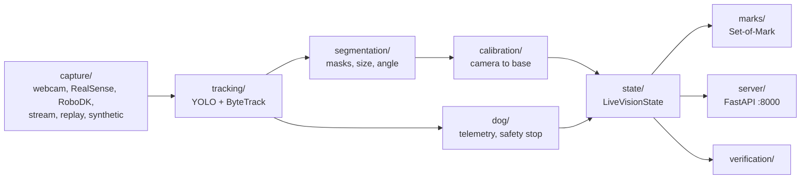

# vision/eyes

Fast local perception, known in the team as Vision A ("the eyes"). It captures frames, detects and tracks objects, measures them, and publishes the result over HTTP and WebSocket. Grok is never called per frame.



## Modules

| Folder | Purpose |
|---|---|
| [`capture/`](capture) | Interchangeable frame sources with one reader interface |
| [`tracking/`](tracking) | Detection, stable IDs, normalised boxes, dominant colour |
| [`segmentation/`](segmentation) | Object masks from an empty-table reference or GrabCut, plus measurements |
| [`depth/`](depth) | Monocular distance estimate when there is no depth camera |
| [`calibration/`](calibration) | ArUco homography, fixed look pose, hand-eye |
| [`marks/`](marks) | Numbered object overlays for video and Grok |
| [`dog/`](dog) | Visual following telemetry and the person or hand safety stop |
| [`state/`](state) | Thread-safe `VisionState` shared with `vision/grok` |
| [`verification/`](verification) | Deterministic checks of whether an object left or arrived |
| [`zoom/`](zoom) | Smooth digital zoom for the desktop demo |
| [`server/`](server) | MJPEG, WebSocket and REST server |

| File | Purpose |
|---|---|
| [`cli.py`](cli.py) | Command line |
| [`pipeline.py`](pipeline.py) | `SourceNode` per camera and the `EyePipeline` loop |
| [`schemas.py`](schemas.py) | `EyeObject`, `FramePayload`, `DogTelemetry`, `CoordsMM` |

## Command line

Run from `computer-vision/`.

```bash
# Live server
python -m vision.eyes.cli run --mode auto --port 8000
python -m vision.eyes.cli run --mode synthetic
python -m vision.eyes.cli run --mode replay --file data/replays/sample_arm.mp4

# One perception cycle, printed as JSON
python -m vision.eyes.cli inspect --mode replay --file data/replays/sample_arm.mp4 --save-marked data/sample_marked.jpg

# Make a replay video
python -m vision.eyes.cli generate-replay --output data/replays/sample_arm.mp4
```

Key options for `run`: `--mode auto|realsense|robodk|webcam|replay|stream|synthetic`, `--device`, `--file`, `--dog-target`, `--fps`, `--host`, `--port`, `--mock-tracker`, `--color-labels`, `--no-webcam`, `--webcam-device`, `--fixed-pose`, `--hand-eye`, `--controller`, `--look-pose`, `--robot-ip`, `--robot-pose controller|robodk`.

In RealSense mode the PC webcam is added as a `webcam` source unless you pass `--no-webcam`.

### Calibration commands

```bash
# Print the A4 ArUco sheet at 100%
python -m vision.eyes.cli calibrate-arm --generate-board logs/aruco_a4.png

# Table homography, needs marker centres in data/calibration/markers_mm.json
python -m vision.eyes.cli calibrate-arm

# Fixed observation pose (recommended)
python -m vision.eyes.cli calibrate-look-pose --table-z-mm 0
python -m vision.eyes.cli calibrate-look-pose --check

# Eye-in-hand
python -m vision.eyes.cli calibrate-hand-eye --tcp controller|manual|robodk|rtde

# Simulation check of what the camera sees and how far off it is
python -m vision.eyes.cli robodk-check
```

A homography holds for the resolution it was made at. Fixed-pose positions are valid only at the observation pose. With a table-empty reference (`POST /empty_table/arm`, from the observation pose), masks work on large uniform objects such as the bucket. Without one they use GrabCut, which can fail there with `invalid_depth`.

## Data format

`bbox` is always `[x, y, w, h]` normalised to 0–1, with `(x, y)` at the top left. `conf` is 0–1. `color` is an Italian colour name. `coords_mm`, `xyz_cam_m`, `xyz_base_m` and `yaw_base_deg` stay `null` until calibration makes them valid.

```json
{"source": "arm", "frame_id": 3, "ts": 1793787986.08,
 "objects": [{"id": 1, "label": "box", "name": null, "conf": 0.87,
              "bbox": [0.7188, 0.5208, 0.1266, 0.1479], "color": "verde",
              "coords_mm": null, "distance_m": 1.2}],
 "dog_telemetry": null, "safety_stop": false, "safety_reason": null}
```

## Server

See [`server/`](server) for routes and [`../../API_APP.md`](../../API_APP.md) for the full contract. IDs from 1000 are Grok detections and IDs from 2000 are YOLO-World tracks.

## Test

```bash
python -m pytest -q tests/test_eyes.py tests/test_segmentation.py tests/test_hand_eye.py tests/test_robodk.py
```
