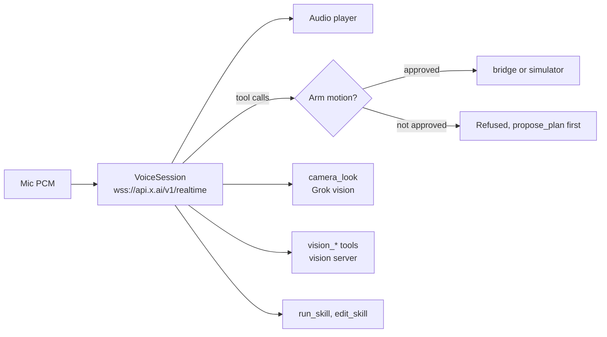

# groky-app

The MOTIQ client: a React Native app, run in Expo Go on a tablet or phone. You talk to **Motion**, a Grok Voice agent that drives a robot arm and a robot dog, looks through cameras to check its work, and saves tasks as skills.

Built with Expo SDK 58, React Native 0.88, React 19 and TypeScript.

## Run

Needs Node 20+ on a laptop for Metro, and [Expo Go](https://expo.dev/go) on the device.

```bash
npm install
cp .env.example .env      # add EXPO_PUBLIC_XAI_API_KEY
npx expo start            # scan the QR code with Expo Go
npx expo start --tunnel   # on venue Wi-Fi
```

With no robot URLs set, the arm and dog are simulated, so the whole app can be demoed without hardware. After changing `.env`, restart with `npx expo start -c`.

Backend URLs must use the robot PC's **LAN IP**. `http://127.0.0.1` from Expo Go is the phone itself. Variables are listed in [`.env.example`](.env.example) and the [root README](../README.md#configuration).

The [`Dockerfile`](Dockerfile) and [`start.sh`](start.sh) run Metro in a container, for example on Coolify, so Expo Go can load the app from a server. `EXPO_PUBLIC_*` values must be runtime variables there, because they are built into the bundle at start.

## App tabs

| Tab | Purpose |
|---|---|
| **Talk** | The orb, live transcript, camera and activity timeline. Open the transcript to type: it works without the mic. |
| **Cameras** | Camera view, **Show Motion**, activity timeline |
| **Robots** | Status, battery, latency, success rate, recent actions, arm speed, stop |
| **Skills** | Create, generate, import, edit, preview, approve and run skills |
| **History** | Everything you've asked, searchable, with pins and tap to run again |

**Settings** holds the theme and **Hardware**, which calls `robot-chooser` to pick the arm and sim backend (`EXPO_PUBLIC_CHOOSER_URL`, or a URL saved on the device).

## How the voice agent works



Audio is 24 kHz PCM. Replies start playing while they stream in. The mic is off while Motion speaks so it can't hear itself, so use the stop button to interrupt. Hearing uses `grok-transcribe` with automatic language detection. `EXPO_PUBLIC_GROK_LANGUAGE_HINT` overrides it.

Grok sees one flat tool list: `dog_*`, `arm_*`, `stop`, `camera_look`, `propose_plan`, `set_full_access`, `run_skill`, `edit_skill`, plus `vision_*` tools when the vision server is set.

### Arm approval

Before any tool that moves the arm, Motion calls `propose_plan` and asks out loud. Arm tools and `run_skill` stay locked in [`session.ts`](src/voice/session.ts) and [`armApproval.ts`](src/lib/armApproval.ts) until **you** say or type a short yes in your language, in the simulator as well. There is no separate Approve card. A no, a stop, a new request or 5 minutes ends the approval, and Grok can't approve its own plan. `arm_verify`, `arm_wait` and `stop` are not locked.

Full access is on at every start, which lets Motion run saved skills without Skills-tab approval. Say "safe mode" to turn it off. The spoken yes is still required.

## Skills

Skills use the MOTIQ skill format, schema 1.1.0. [`pick_place_ur5e.json`](src/skills/templates/pick_place_ur5e.json) is the reference, and the arm's tools and limits are read straight from it. The app adds `robot.device` (`arm` or `dog`) and an `app` block. A skill file made for another robot is refused when run as an arm skill.

| Stage | How it works |
|---|---|
| **Create** | Blank, Grok from a prompt, JSON import, a voice command (`fromVoice.ts`), the camera (`fromVision.ts`), or a video via the teach server |
| **Edit** | Form for steps, primitives, objects and success conditions, plus a JSON tab |
| **Check** | Dry run through the UR5e model, 2D preview, and the hardware capability check in `hardware.ts` |
| **Run** | `runner.ts`. DETECT and VERIFY use the vision server or Grok vision. On the bridge, PICK and PLACE are one controller task each. |
| **Store** | AsyncStorage, plus the PC copy for learned skills (`store.ts`) |

`RETRY_WITH_REOBSERVATION` retries a step once after looking again. Other failure policies stop the skill.

**Gates.** A skill only reaches hardware when `review.approved` and `safety.physical_execution_allowed` are both true, or full access is on. Saving an edit drops the approval. With `unknown_parameters_policy: NEEDS_VALIDATION`, the default, a real run refuses to move to an object whose position wasn't measured by a calibrated camera. `USE_SKILL_VALUES` trusts the file.

The film icon on a skill card (or Preview in the editor) replays the dry run as a 2D side view of the arm, and flags steps that would be refused, grasps that would close on nothing and checks that would fail. The arm drawing is a 2-link sketch of the real 6 joints. Logic in `src/preview/scene.ts`.

**Not modelled:** collisions with anything but the table, gripper fingers and payload. The UR safety configuration stays the hard limit.

The built-in skills are pick and place, *Visit the orange screw*, *Pick & place (arm controller)*, *Down 5 cm & up (physical arm)*, *Visit the green ring (physical arm)*, *Hand it over*, *Reset arm*, *Greet visitors*, *Short patrol* and *Rest*.

## Robot protocol

Each robot sits behind a small HTTP server, so the app doesn't care which SDK drives the hardware.

| Route | Rule |
|---|---|
| `GET /health` | 200 and JSON when connected |
| `POST /tools/<name>` | JSON in, JSON out, ideally `{ "ok": true }` |
| `POST /tools/stop` | Must always work and return fast |
| `GET /camera.jpg` | Optional. Shows up as a camera automatically. |

Requests carry `X-Bridge-Key` when one is set. Tool names and arguments are in [`tools.ts`](src/devices/tools.ts). Replies can include `tcp_pose`, `joints_deg` and `object_detected`, so the app tracks the real arm instead of its prediction. The arm implementation is [`robot_controller/bridge/`](../robot_controller/bridge). The dog bridge is not in this repository.

## Code map

```text
App.tsx          shell: sidebar, top bar, tabs
src/screens/     Talk, Cameras, Robots, Skills, History
src/components/  Orb, camera panel, activity, skill editor and preview, settings, UI kit
src/hooks/       useVoice, useCamera, useDevices, useSkills, useHistory, notifications
src/voice/       Grok realtime session, prompt, audio, transcription
src/devices/     Tool definitions, bridge client, simulator
src/robot/       UR5e kinematics, arm model and limits, live arm state, detect and verify
src/skills/      Format, generation, validation, dry run, runner, hardware check, stores
src/lib/         Config, cameras, vision, approval, full access, chooser, recorder
src/preview/     2D skill preview timeline
scripts/         Offline voice checks
assets/          Icons and splash
```

## Development

```bash
npm run typecheck
npm run lint
npm run format
npm run test:voice     # multilingual hearing and yes/no checks, no Expo runtime
```

## Known limits

- The mic is ignored while Motion talks, so you can't interrupt by voice.
- `EXPO_PUBLIC_XAI_API_KEY` is bundled into the app. Use it on your own devices only.
- The token endpoint's response format isn't documented. `src/voice/token.ts` accepts the likely shapes.
- The dog profile is a placeholder until its hardware is confirmed.
- Web works for development, but Expo Go on a device is the supported client.
