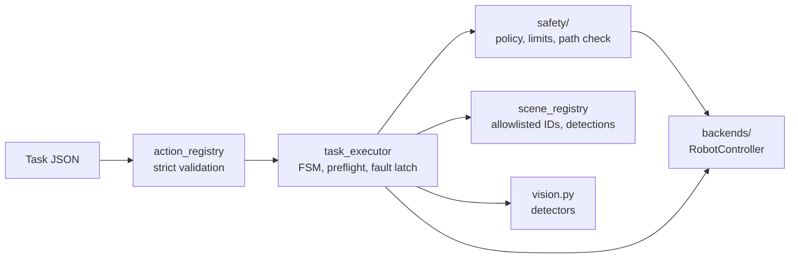

# robot_control

The controller package. Everything at a boundary uses metres and radians, and backends convert explicitly to vendor units.

| File | Purpose |
|---|---|
| `models.py` | Actions, task states, error codes, poses, events |
| `config.py` | Robot, scene and safety configs with cross-validation |
| `controller.py` | The `RobotController` contract shared by every backend |
| `action_registry.py` | AI tool allowlist and strict task validation |
| `scene_registry.py` | Allowlisted objects, destinations, targets, patterns, motions, and detections |
| `task_executor.py` | Sequential runner with an explicit FSM, cancel, timeouts and fault latching |
| `vision.py` | `MockDetector`, `NoDetector` and `VisionEyesFileDetector` |
| `live.py` | Terminal view, live JSON file and telemetry thread |
| `cli.py` | Command line |

| Folder | Purpose |
|---|---|
| [`api/`](api) | Optional FastAPI server and dashboard |
| [`backends/`](backends) | Mock, PyBullet, URSim sync and the disabled physical adapter |
| [`safety/`](safety) | The fail-closed software gate |
| [`sim_objects/`](sim_objects) | Demo object geometry, validation and PyBullet import |

`move_joints` and `move_*` on a controller are internal. They are never exposed to the AI.
